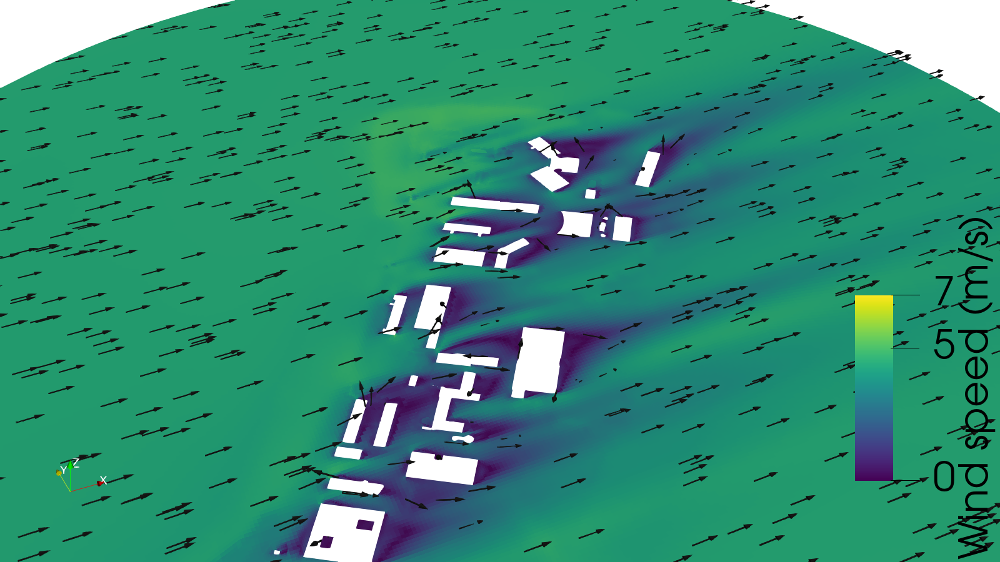

# DLR Oberpfaffenhofen: wind simulation

Henry's work on the DLR scene (`dlr_site_*_mm(1).stl` in the repo root). The site is DLR Oberpfaffenhofen, next to the EDMO airfield.



*Steady wind about 7 m above ground (z = 26 m; z = 0 is not the ground, which sits at about 13–25 m). West wind at 5 m/s. Purple pockets are the sheltered and recirculating air behind the buildings. No turbine yet.*

*The slice only affects how the result is viewed, not the simulation: `simpleFoam` computes the full 3D field. Change the height with `SLICE_Z=35 pvpython scripts/wind_view.py out.png`.*

## What is here

| Folder | Content |
|---|---|
| `windCase/` | OpenFOAM v2306 case. It's Arthur's `windCase.zip` (mesh) plus a solver setup taken from the OpenFOAM `turbineSiting` tutorial. |
| `scripts/extend_terrain.py` | Extends the terrain with flat ground (see below). |
| `scripts/wind_view.py` | Builds the ParaView view: a horizontal slice coloured by wind speed, arrows and buildings. |
| `Open Wind View.command` | Double-click on macOS to open that view in ParaView 6.2. |
| `wind-data/` | 2016–2025 wind reports from the EDMO airfield (IEM archive), with fetch and summary scripts. See its README. |
| `results/` | Saved pictures. |

## How to run

```sh
cd DLR/windCase
/Applications/OpenFOAM-v2306.app/Contents/Resources/etc/openfoam   # or source your OpenFOAM v2306
pip install numpy trimesh scipy                                     # for make_case.py and extend_terrain.py
./Allrun.noturbine
```

`Allrun.noturbine` runs these steps:
1. copy the STLs from the repo root;
2. extend the terrain;
3. `make_case.py` (mm to m, recentre, cylinder domain);
4. build the mesh: `blockMesh`, `snappyHexMesh`;
5. split the cylinder side into an inlet (facing west) and an outlet;
6. `simpleFoam` on 6 cores.

It takes about 10 min to mesh and 50 min to solve on an Intel MacBook (16 GB), for 1.19 M cells. Outputs are git-ignored; rerun to regenerate them. Then open `windCase/dlr.foam` in ParaView, or double-click `Open Wind View.command`.

## Setup and assumptions

- **Turbulence:** steady RANS, k-ε (`simpleFoam`), the same as the `turbineSiting` tutorial.
- **Inflow:** a log-law profile (`atmBoundaryLayerInlet*`), 5 m/s at 10 m, from the west (270°), with z0 = 0.1 m.
  - **This is a placeholder.** EDMO says the prevailing wind is SW at about 3 m/s.
- **Domain:** a cylinder with an 882 m radius.
  - The original terrain STL is a diagonal strip. The largest circle it fully covers is only 123 m, which cuts off most of the campus.
  - `extend_terrain.py` keeps the real heights inside the strip and adds **flat ground** at the median height outside it, with a 60 m blend.
  - **The flat part is invented.** Real DGM1 terrain would replace it.
- **Mesh:** 16 m base cells, 4 m in the campus box, about 2 m at the buildings.
  - `checkMesh` flags 5 highly skewed faces out of 3.7 M; everything else passes.
- **Convergence:** residuals at about 1e-6 to 1e-8 after 600 iterations.
  - Sanity check: 8.3 m/s at 210 m above ground matches the log law.
  - The campus slows the wind at 35 m by about 10% (5.5 to 4.9 m/s). The flow speeds up slightly over the buildings at 60 m. The effect fades by 120 m.

## Changes to Arthur's windCase

- `Allrun` called `surfaceFeatures`, which is the OpenFOAM.org name. In v2306 (ESI) the tool is `surfaceFeatureExtract`, which needs `surfaceFeatureExtractDict`.
- The zip only meshes. I added `0.orig/`, `constant/turbulenceProperties` and `transportProperties`, the solver settings, and the inlet/outlet split (`topoSetDict.inletOutlet` and `createPatchDict`).

## Not done yet / open

- **No validation yet.** EDMO is the inflow reference. The comparison point would be the DLR weather station inside the campus (see `wind-data/README.md`), but its data is only published as plots and stops in October 2024. We need the raw data.
- **No mesh study yet.** Run coarse, medium and fine meshes, and check that the result barely changes.
- **No turbine yet.** It's planned after validation. We still need to choose the model, the position and a reference for its wake.
